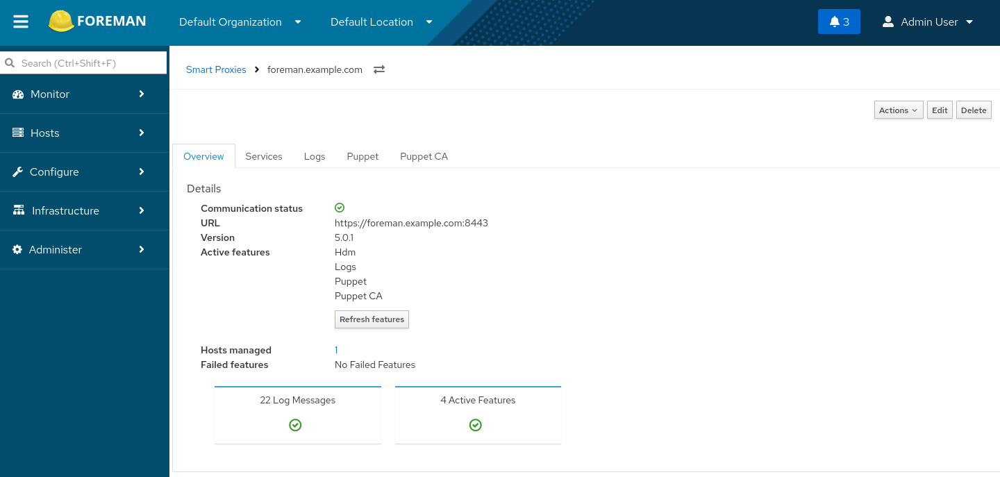

# Run Foreman in a Container

This project aims for running Foreman in a Container, e.g. for quickly fiddling around with Foreman in context of plugin development.

## Debian 13 (Trixie)

```sh
podman build . -t foreman:trixie -f Containerfile.trixie
```
```sh
podman run \
    -p 9443:443 \
    -p 8443:8443 \
    --tmpfs /tmp \
    --tmpfs /run \
    --tmpfs /run/lock \
    --cgroupns=host \
    -v /sys/fs/cgroup:/sys/fs/cgroup:rw \
    --hostname foreman.example.com \
    --name foreman-trixie \
    -ti foreman:trixie
```

## Ubuntu 24.04 (Noble)
```sh
podman build . -t foreman:noble -f Containerfile.noble
```
```sh
podman run \
    -p 9443:443 \
    -p 8443:8443 \
    --tmpfs /tmp \
    --tmpfs /run \
    --tmpfs /run/lock \
    --cgroupns=host \
    -v /sys/fs/cgroup:/sys/fs/cgroup:rw \
    --hostname foreman.example.com \
    --name foreman-noble \
    -ti foreman:noble
```

## Installer arguments

The `foreman-installer` gets started with a couple of arguments which can be modified using environment variables.

| Variable                           | Default | Description                                                                                         |
| :--------------------------------- | :-----: | :-------------------------------------------------------------------------------------------------- |
| FOREMAN_LOG_LEVEL                  | notice  | Log level for log based terminal output. The available levels are ERROR, WARN, NOTICE, INFO, DEBUG. |
| FOREMAN_DB_POOL                    | 50      | Size of database connection pool                                                                    |
| FOREMAN_DYNFLOW_WORKER_INSTANCES   | 1       | The number of worker instances that should be running                                               |
| FOREMAN_DYNFLOW_WORKER_CONCURRENCY | 1       | How many concurrent jobs to handle per worker instance                                              |
| FOREMAN_SERVICE_PUMA_WORKERS       | 1       | Number of workers for Puma.                                                                         |
| FOREMAN_SERVICE_PUMA_THREADS_MAX   | 1       | Maximum number of threads for every Puma worker                                                     |
| FOREMAN_ADDITIONAL_INSTALLER_ARGS  |         | Additional installer arguments                                                                      |
## Additional installer arguments

Additional `foreman-installer` arguments can be passed with `FOREMAN_ADDITIONAL_INSTALLER_ARGS`, e.g. for enabling the HDM integration.

```sh
podman run \
    ...
    -e FOREMAN_ADDITIONAL_INSTALLER_ARGS='--enable-foreman-plugin-hdm --enable-foreman-proxy-plugin-hdm --foreman-proxy-plugin-hdm-hdm-url <hdm-url> --foreman-proxy-plugin-hdm-hdm-user <hdm-api-user> --foreman-proxy-plugin-hdm-hdm-password <hdm-api-user-password>' \
    ...
```

## Accessing the Foreman server

Access Foreman server using a web browser pointed to https://localhost:9443

Initial credentials will be printed to the logs, e.g.

```
Success!
  * Foreman is running at https://foreman.example.com
      Initial credentials are admin / Lhnp2hojS2xDh6DX
  * Foreman Proxy is running at https://foreman.example.com:8443
```

## Connect Foreman to HDM

Create a `bridge` network which will connect HDM and Foreman

```sh
podman network create foreman
```

Start Hiera Data Manager (HDM)

```sh
podman run \
    -p 3000:3000 \
    -e DEVELOP=1 \
    -e SECRET_KEY_BASE=$(openssl rand -hex 16) \
    -it -d \
    --network foreman \
    --name hdm \
    ghcr.io/betadots/hdm:development
```

The HDM web ui will be accessible from http://localhost:3000 and from inside the `foreman` network using http://hdm:3000

After setting up an API user in HDM, e.g. `api` / `64b5199d6ee90fd1409ec8d45fb12f24` , you can run Foreman

```sh
podman run \
    ...
    --network foreman \
    -e FOREMAN_ADDITIONAL_INSTALLER_ARGS='--enable-foreman-plugin-hdm --enable-foreman-proxy-plugin-hdm --foreman-proxy-plugin-hdm-hdm-url http://hdm:3000 --foreman-proxy-plugin-hdm-hdm-user api --foreman-proxy-plugin-hdm-hdm-password 64b5199d6ee90fd1409ec8d45fb12f24' \
    ...
```
When set up properly, the **Smart Proxies** overview should show `Hdm` listed under **Active features**


